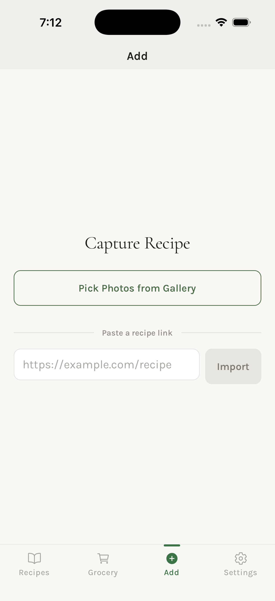
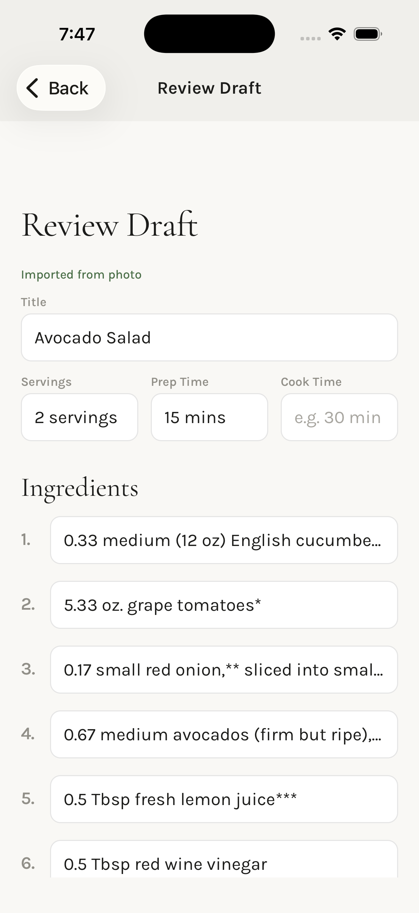
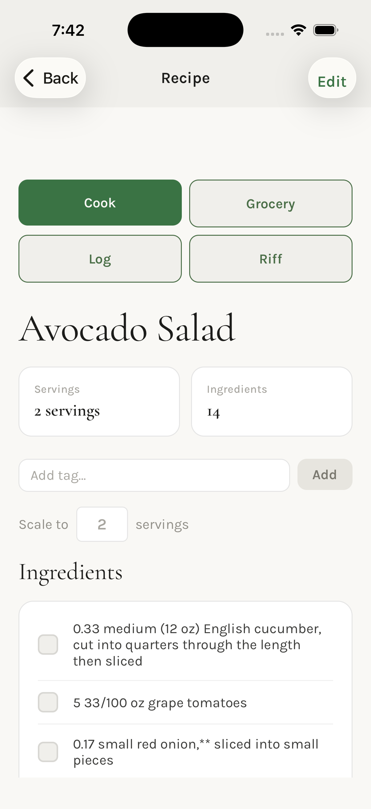
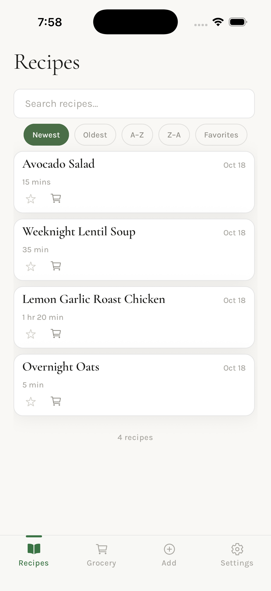
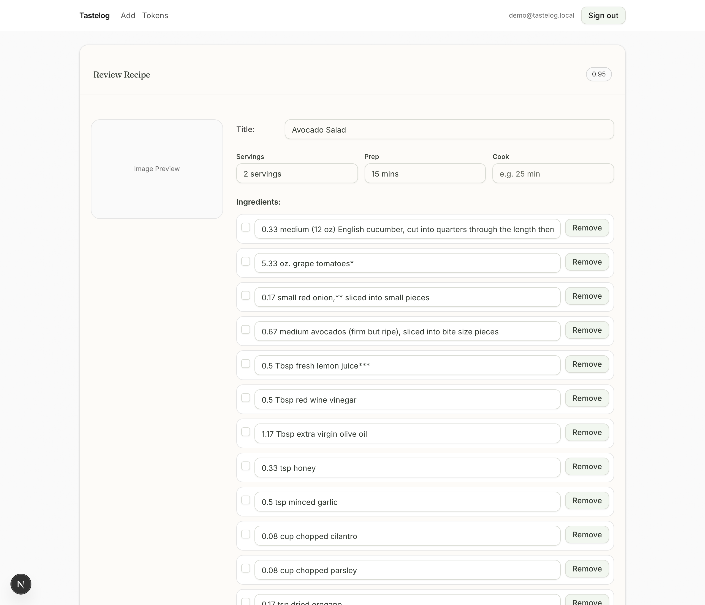

# Tastelog


Capture a recipe from a photo, a screenshot, a PDF, or a URL. Tastelog parses it with Claude Vision into structured ingredients and steps, lets you review and correct the draft, then stores it in a searchable personal cookbook with grocery lists, cook history, exact-fraction scaling, and an AI "riff" mode for adapting a recipe in conversation.

Three clients share one FastAPI backend: a Next.js web app, an Expo / React Native iOS app with a native Swift share extension, and an iOS Shortcuts flow.

> Extracted from a private repository on 2026-10-16. History squashed to a single commit; internal planning docs removed. Everything else is the real code.

## What it does

- **Capture** an image, PDF, or URL. The backend uploads the file to Supabase Storage, sends it to Claude Vision, and returns a draft with a confidence score.
- **Review** the draft on web or mobile, fix anything the model got wrong, confirm it into a recipe.
- **Search** by title or ingredient using Postgres full-text search with an ILIKE fallback.
- **Scale** ingredients with exact rational arithmetic (BigInt fractions, never floats).
- **Grocery lists** built from a recipe, with manual adds and per-item checkoff.
- **Cook mode and cook log**: step-through cooking view, voice commands, history of what you cooked and when.
- **Riff**: a streaming Claude conversation anchored to a recipe ("make it vegan", "halve it for two"), with one-tap save of the adapted recipe.
- **Capture tokens**: scoped, revocable bearer tokens so the iOS share extension and Shortcuts can capture without holding the user's session.

## What it looks like

<p>
  
  
  
  
</p>
<p>
  
</p>

Real captures of a printed recipe page through the local demo stack with a live model (the demo itself runs with a stub and needs no key). Taken on 2026-10-18 by `scripts/web-journey.mjs` for the web and from the iOS simulator for the app.

## Architecture

```
 iOS app (Expo)  ─┐
 Web app (Next.js)┼─ Supabase JWT ─────▶  FastAPI  ──▶  Supabase Postgres (RLS)
 Share extension ─┐                        │     │  ──▶  Supabase Storage
 iOS Shortcuts   ─┴─ Bearer tl_cap_* ─────▶│     └────▶  Claude (vision + riff)
```

- **api/** FastAPI with an app factory, Pydantic v2 models at every boundary, JWKS-verified Supabase JWTs, Postgres-backed idempotency keys, per-token rate limiting, SSE streaming for riff. Settings fail fast on boot if misconfigured.
- **tastelog-web/** Next.js 16 / React 19 / Tailwind v4 / shadcn. Every API response is validated with Zod schemas that mirror the Python models. `/api/*` is proxied to the backend by a Next rewrite.
- **tastelog-mobile/** Expo SDK 54, Expo Router, NativeWind, TanStack Query. The share extension is native Swift and never sees the Supabase session; it reads only a scoped capture token the app shares with it through the App Group.
- **migrations/** Plain SQL, applied in order, with a drift-check script and proof tests under `tests/db/`.
- **loadtests/** k6 scenarios plus a Python seed/cleanup harness, with target guards that refuse to point at production.

Full component and schema reference: [docs/architecture.md](docs/architecture.md). Data contracts and migration workflow: [docs/migrations.md](docs/migrations.md).

## Run it locally

Requirements: Python 3.12, Node 20 for the web app, Node 24 for the mobile app (its test suite hangs under Node 20). The full-stack demo also needs Docker, the [Supabase CLI](https://supabase.com/docs/guides/local-development), `psql` and `curl`; no hosted account or paid key is needed for it.

**Backend**

```bash
python3.12 -m venv api/.venv && source api/.venv/bin/activate
pip install pip-tools && make sync-dev      # hash-verified install from the lockfile
cp .env.example .env                        # placeholder keys; tests run as-is
make test                                   # 948 tests, no network
make dev                                    # http://localhost:8000, docs at /docs
```

**Full stack, no accounts** (Docker + Supabase CLI)

```bash
make demo                                   # local Supabase, schema, demo login, 3 recipes, env files
cp .env.demo .env && make demo-api          # API on http://localhost:8000, Claude replaced by a stub
cp tastelog-web/.env.demo.local tastelog-web/.env.local
(cd tastelog-web && npm ci && npm run dev)  # http://localhost:3000, log in as demo@tastelog.local / demo-password
supabase stop                               # when done
```

`make demo` starts Postgres, PostgREST, Auth and Storage with the Supabase CLI, applies `db/bootstrap/000_base_schema.sql` plus every migration, creates the demo user and three sample recipes, and writes `.env.demo` and `tastelog-web/.env.demo.local` pointing at that stack. The API verifies the local tokens through JWKS exactly as it does in production (the CLI signs them with a generated ES256 key). With `ANTHROPIC_STUB_MODE=deterministic` the capture route returns a fixed draft instead of calling Claude, so the whole journey works offline: log in, capture any image, correct the draft, confirm, and reload the saved recipe. `/health/ready` reports `compatible` against this database. To run against real data instead, put a hosted Supabase project and an Anthropic key in `.env`.

**Web**

```bash
cd tastelog-web
npm ci && cp .env.example .env.local
npm test                                    # 174 tests
npm run dev                                 # http://localhost:3000
```

**Mobile**

```bash
cd tastelog-mobile
npm ci && cp .env.example .env              # for the demo stack, use SUPABASE_ANON_KEY from ../.env.demo
npm test                                    # 1311 tests across 83 suites
SENTRY_DISABLE_AUTO_UPLOAD=true npx expo run:ios   # native dev build; Expo Go cannot load this app (see tastelog-mobile/README.md)
```

## Tests

| Suite | Runner | Count | Needs |
|---|---|---|---|
| Backend | pytest | 948 | placeholder `.env` only |
| Web | vitest | 174 | nothing |
| Mobile | jest | 1311 | nothing |
| Migrations | real PostgreSQL 17.6 (`tests/db/run_db_proof.sh`) | base schema + 003..028, concurrency batteries | Docker |

All four run in [CI](.github/workflows/ci.yml) on pushes to `main` and on pull requests. The web job also runs lint, strict TypeScript and `next build`; the mobile job runs strict TypeScript. The web review-and-confirm journey is covered without a browser and without a database: `tastelog-web/src/lib/drafts/reviewPatch.test.ts` proves the form's adapter and patch builder, and the confirm tests in `tests/test_drafts.py` prove the route forwards those overrides to the confirm RPC (mocked). Persistence and reload through a real database are not covered in CI; `scripts/web-journey.mjs` drives the real pages in a headless browser against the local demo stack (log in, upload, review, confirm, reload the saved recipe) and is run by hand, since Playwright is not a dependency of this repository.

## Things worth reading

- `api/core/jwt.py` JWKS fetch with caching and key-rotation retry; RS256 and ES256.
- `api/core/draft_idempotency.py` + `migrations/028_draft_capture_idempotency.sql` idempotency on both draft capture routes, keyed by user. The API mints the draft id before reserving the key inside one insert-first RPC, so a retry that carries the same key and the same bytes never creates a second draft: a concurrent retry gets 409 with `Retry-After` while the first is running, a finished key replays the recorded draft, and a retry after a lost response or a crash between writing the draft and recording it recovers that exact draft by id. Complete and release match on the draft id, so a stale request can never act on another request's reservation. The guarantee is as good as the client's key: web and mobile keep one key per chosen input, so "Try Again" replays the attempt and a new photo or URL starts a new one; the Swift extension has no retry button, so each share is one attempt. Keys expire after 24 hours. Proven on real PostgreSQL in `tests/db/proof_migration_028.sql` (ownership, recovery, no takeover) and `run_db_proof.sh` C-ID1 (the race).
- `api/core/idempotency.py` the older, token-scoped keys on the Shortcuts capture route (`/api/recipes/capture`): a retry with the same key replays the recorded response, but a retry that races the first attempt before its response is recorded can still duplicate. Not yet moved to the 028 model.
- `api/core/token_auth.py` capture tokens: SHA-256 at rest, scoped, revocable, rate-limited.
- `tastelog-web/src/lib/ingredients/` the exact-fraction scaling engine and its parser for inputs like "1 1/2 cups".
- `tastelog-mobile/ios/TastelogShareExtension/` the Swift share extension, and `scripts/CaptureFailureMapperContract.swift`, a contract test for its error mapping.
- `tests/test_search_secret_hygiene.py` and `loadtests/k6/lib/target-guard.js` guards that keep secrets out of logs and load tests off production.
- [docs/CASE_STUDY.md](docs/CASE_STUDY.md) the problem, the constraints, three decisions, the two bugs this public copy opened with and what changed, and what the scorecard says.
- [docs/SCORECARD.md](docs/SCORECARD.md) what capture actually keeps and invents on nine real inputs, with cost and latency per capture, a prompt-ablation baseline, and three failures shown with their raw model output. Small N, descriptive, reproducible from `tests/eval/fidelity/`.

## Repository layout

```
api/              FastAPI backend (core/, models/, routes/, tests/)
tests/            Backend tests incl. tests/db/ SQL proof migrations
migrations/       Ordered SQL migrations
tastelog-web/     Next.js app
tastelog-mobile/  Expo app + native iOS share extension
loadtests/        k6 + Python load-test harness
scripts/          Migration drift check, API test runner, Swift contract harness
docs/             Architecture, deploy topology, migrations, iOS Shortcuts guide, case study, capture scorecard
capture.py …      Original Phase 0 CLI tools, thin wrappers over api/core
```

## License

MIT. See [LICENSE](LICENSE).
