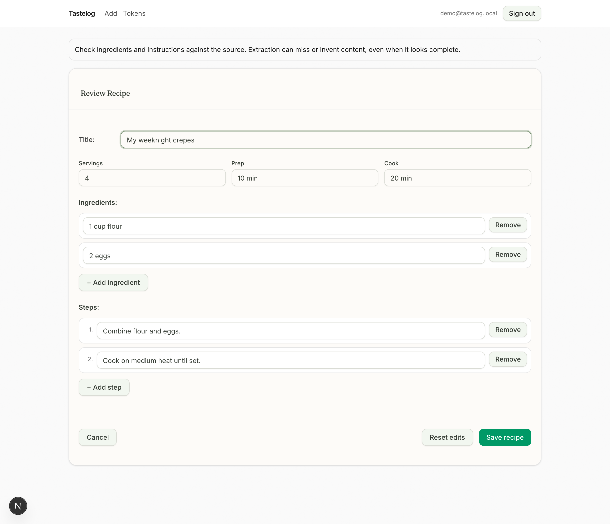

# Tastelog

Capture a recipe, correct the draft, save it to your cookbook. Web and iOS clients with a Python backend.



## Run the web demo

Requires Python 3.12, Node.js 20 or 24, Docker running, Supabase CLI, PostgreSQL's `psql`, Poppler, `make` and `curl`.

```bash
git clone https://github.com/Bbuju055/tastelog-app.git
cd tastelog-app
python3.12 -m venv api/.venv
api/.venv/bin/python -m pip install -r requirements-dev.txt
npm --prefix tastelog-web ci
make demo
```

Start the API:

```bash
make demo-api PYTHON=api/.venv/bin/python
```

In another terminal:

```bash
make demo-web
```

Open **http://localhost:3000**. Sign in with **demo@tastelog.local** / **demo-password**.
Upload `tests/eval/fidelity/inputs/avocado_salad.pdf`, edit the draft, save, then search for it.

**No account or paid API key needed.** The demo returns a fixed crepe recipe for every supported input. Auth, storage and saving use a real local database. PDFs must be single-page; extracted content still needs review.

Stop the two servers with Ctrl+C, then run `supabase stop`.

## Test

```bash
make test PYTHON=api/.venv/bin/python
npm --prefix tastelog-web test
bash tests/db/run_db_proof.sh
```

[iOS setup](tastelog-mobile/README.md) · [Technical docs](docs/architecture.md) · [Evaluation](docs/SCORECARD.md) · [MIT license](LICENSE)
